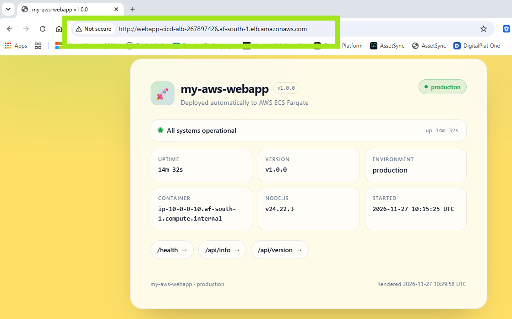
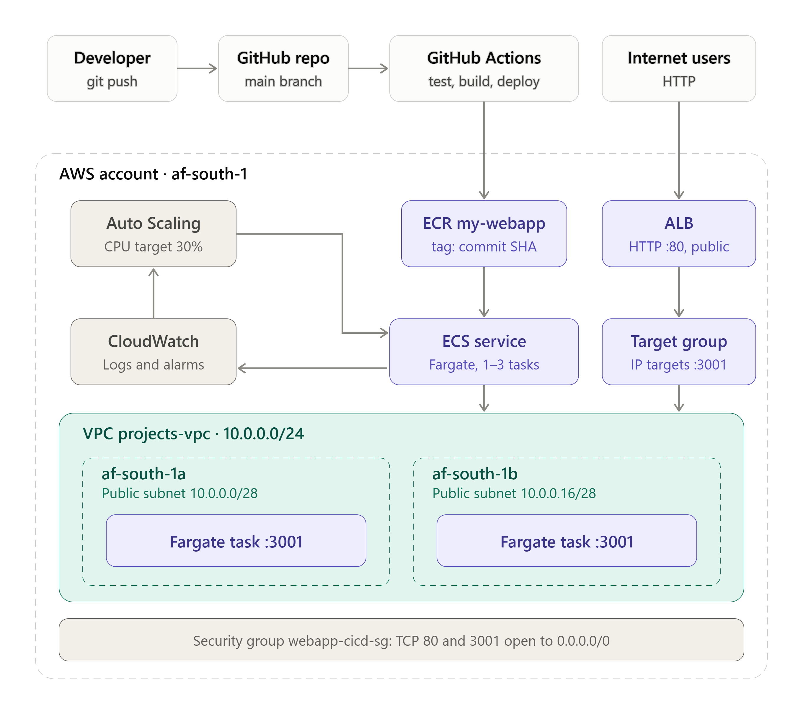
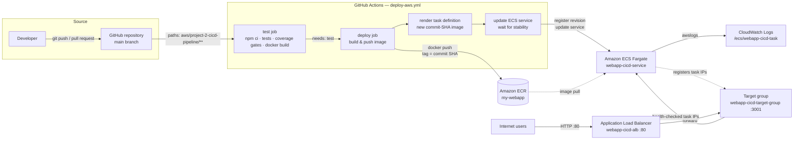
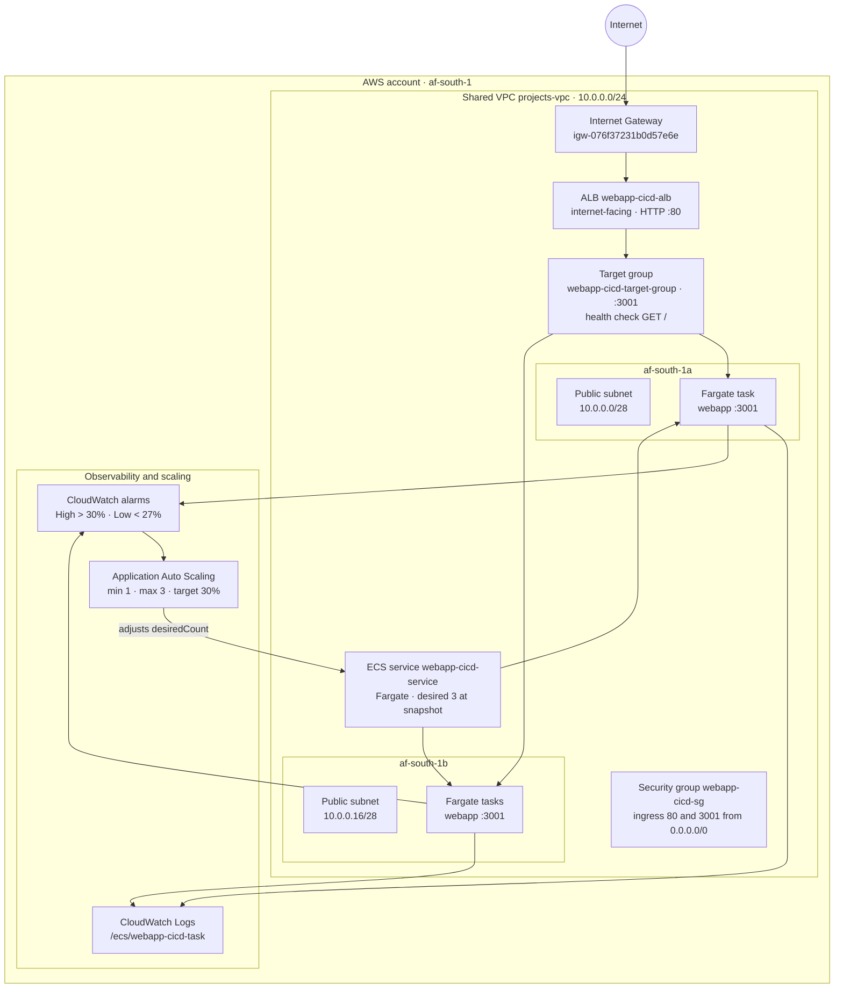
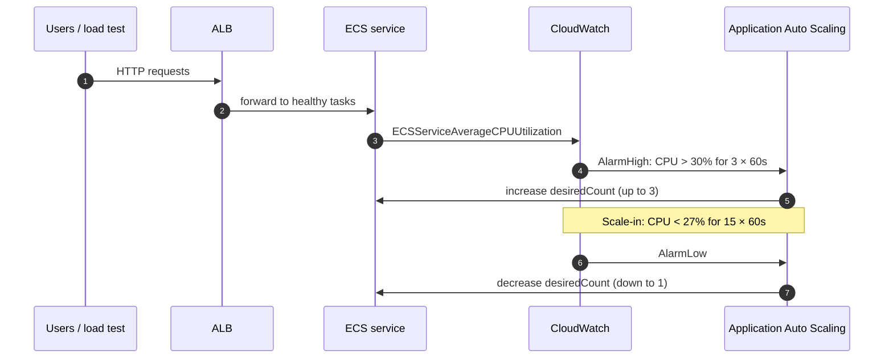

# Architecture — Project 2 CI/CD Pipeline (AWS)

End-to-end architecture for the Express application in
`aws/project-2-cicd-pipeline`, deployed in region **`af-south-1`**
(Africa/Cape Town).

The diagrams below describe the **live stack**, verified on **2026-11-27**.
Where the Terraform state and the live account disagree, the live values are
used and the drift is called out in [State drift](#state-drift).

---

## 1. At a glance

| Layer | Service | Live resource |
| --- | --- | --- |
| Source & CI | GitHub Actions | `.github/workflows/deploy-aws.yml` |
| Image registry | Amazon ECR | `my-webapp` |
| Compute | Amazon ECS on Fargate | cluster `webapp-cicd-cluster`, service `webapp-cicd-service` |
| Entry point | Application Load Balancer | `webapp-cicd-alb` (HTTP `:80`) |
| Routing | ALB target group | `webapp-cicd-target-group` (`:3001`, IP targets) |
| Scaling | Application Auto Scaling | CPU target tracking, min `1`, max `3`, target `30%` |
| Logs | CloudWatch Logs | `/ecs/webapp-cicd-task` |
| Networking | Shared VPC | `projects-vpc` (`10.0.0.0/24`), two public subnets |
| Deploy identity | IAM user | `github-actions-user` |
| Task identity | IAM role | `ecsTaskExecutionRole-webapp-cicd-cluster` |

Live URL:

```text
http://webapp-cicd-alb-267897426.af-south-1.elb.amazonaws.com/
```



Verified response at snapshot time:

```text
GET /          -> HTTP 200
GET /health    -> {"status":"healthy","version":"1.0.0","environment":"production",...}
GET /api/info  -> {"app":"my-aws-webapp","version":"1.0.0",...}
```

---

## 2. Architecture diagram



### 2.1 CI/CD and request path



### 2.2 Network and scaling



### 2.3 ASCII fallback

```text
                         ┌──────────────────────────────────┐
                         │ GitHub repository (main branch)  │
                         └────────────────┬─────────────────┘
                                          │ push / pull request
                                          ▼
                         ┌──────────────────────────────────┐
                         │ GitHub Actions deploy-aws.yml    │
                         │  1. test + coverage gates        │
                         │  2. build Docker image           │
                         │  3. push image (commit SHA tag)  │
                         │  4. render task definition       │
                         │  5. update ECS service           │
                         └───────────┬──────────────┬───────┘
                                     │              │
                          push image │              │ update service
                                     ▼              ▼
                         ┌───────────────────┐  ┌─────────────────────────┐
                         │ Amazon ECR        │  │ ECS Fargate             │
                         │ my-webapp         │─▶│ webapp-cicd-service     │
                         └───────────────────┘  └──────┬──────────┬───────┘
                                                       │          │
                                           logs        │          │ register
                                                       ▼          ▼ task IPs
                                           ┌────────────────┐  ┌──────────────────┐
                                           │ CloudWatch     │  │ Target group     │
                                           │ Logs           │  │ :3001            │
                                           └────────────────┘  └────────┬─────────┘
                                                                        │
                                                     ┌──────────────────▼─────────┐
                                                     │ ALB webapp-cicd-alb :80    │
                                                     └──────────────▲─────────────┘
                                                                    │ HTTP
                                                              ┌─────┴─────┐
                                                              │ Internet  │
                                                              └───────────┘
```

---

## 3. Request flow

1. A user resolves `webapp-cicd-alb-267897426.af-south-1.elb.amazonaws.com`
   and sends HTTP traffic to port `80`.
2. The internet-facing ALB listener forwards **100%** of traffic to
   `webapp-cicd-target-group`; stickiness is disabled.
3. The target group is an **IP target group** on port `3001`. ECS registers each
   task's `awsvpc` ENI address as a target.
4. The ALB sends requests only to targets that pass `GET /` with a `200`
   response (every 30s; 5 successes to become healthy, 2 failures to become
   unhealthy).
5. The container logs stdout/stderr to CloudWatch Logs through the `awslogs`
   driver.
6. Tasks run in the two public subnets and have public IPs, so port `3001` is
   also directly reachable. The ALB DNS name is the stable URL to use.

---

## 4. CI/CD pipeline

Workflow: [`.github/workflows/deploy-aws.yml`](../../../.github/workflows/deploy-aws.yml)

### Trigger

- Push to `main` that touches `aws/project-2-cicd-pipeline/**` or the workflow.
- Pull request to `main` with the same path filters (test job only).
- Manual `workflow_dispatch`.

### Test job

1. Checkout the repository.
2. Install Node.js 18 and run `npm ci`.
3. Run `npm run test:coverage`.
4. Enforce coverage thresholds with `npm run coverage:check`.
5. Publish and upload the coverage report.
6. Build the Docker image to validate the `Dockerfile`.

### Deploy job

Runs only on `main` and only after the test job succeeds.

1. Validate that the required repository secrets resolve.
2. Authenticate to AWS with `AWS_ACCESS_KEY_ID` /
   `AWS_SECRET_ACCESS_KEY` for `github-actions-user`.
3. Log in to Amazon ECR.
4. Build and push the image tagged with the **full commit SHA**.
5. Download the current task definition (`webapp-cicd-task`).
6. Render a new revision with the new image for the `webapp` container.
7. Deploy the revision to `webapp-cicd-service` and wait for service stability.
8. Print the task public IP and console links.

Terraform deliberately does **not** own task-definition revisions or the
service's desired count; those are owned by CI and Application Auto Scaling
respectively.

---

## 5. Live resource inventory

### Workload

| Item | Value |
| --- | --- |
| ECS cluster | `webapp-cicd-cluster` |
| ECS service | `webapp-cicd-service` (Fargate, `ACTIVE`) |
| Desired / running at snapshot | `3` / `3` (scaled out by the load test) |
| Task definition family | `webapp-cicd-task` |
| Live revision | `26` (Terraform state tracks `25`) |
| Task size | `256` CPU units (0.25 vCPU), `512` MiB |
| Network mode | `awsvpc`, public IP enabled |
| Container | `webapp`, port `3001`, `ENVIRONMENT=production` |
| Image | `123456789012.dkr.ecr.af-south-1.amazonaws.com/my-webapp:49282bdcee26e69e3acd563cc47bbb1173c4c1fd` |
| Execution role | `ecsTaskExecutionRole-webapp-cicd-cluster` |
| Log group | `/ecs/webapp-cicd-task` (no retention configured) |

### Registry

| Item | Value |
| --- | --- |
| Repository | `my-webapp` |
| URI | `123456789012.dkr.ecr.af-south-1.amazonaws.com/my-webapp` |
| Scan on push | enabled |
| Tag mutability | mutable |
| Lifecycle policy | keep 1 tagged + 1 untagged image |
| Encryption | AES-256 |

### Load balancing and networking

| Item | Value |
| --- | --- |
| ALB | `webapp-cicd-alb` (internet-facing, active) |
| ALB DNS | `webapp-cicd-alb-267897426.af-south-1.elb.amazonaws.com` |
| Listener | HTTP `:80` → forward to target group |
| Target group | `webapp-cicd-target-group`, HTTP `:3001`, type `ip` |
| Health check | `GET /`, matcher `200`, interval `30s`, timeout `5s` |
| Deregistration delay | `300s` |
| VPC | `projects-vpc` / `vpc-0c37e8d80dfbf822e` / `10.0.0.0/24` |
| Public subnets | `subnet-0461689d64a48fc1d` (`af-south-1a`, `10.0.0.0/28`), `subnet-032c6773d95d84e93` (`af-south-1b`, `10.0.0.16/28`) |
| Internet gateway | `igw-076f37231b0d57e6e` |
| Public route table | `rtb-097b37cae20926c47`, `0.0.0.0/0` → internet gateway |
| Security group | `webapp-cicd-sg` / `sg-0fceddfefa122f5a2` |
| Ingress | TCP `80` and `3001` from `0.0.0.0/0` |
| Egress | all traffic to `0.0.0.0/0` |

The VPC also contains two private subnets
(`projects-vpc-subnet-private1-af-south-1a` and `-private2-af-south-1b`), but
this project does not use them. There is no NAT gateway.

### Scaling and observability

| Item | Value |
| --- | --- |
| Scalable target | `service/webapp-cicd-cluster/webapp-cicd-service` |
| Capacity | min `1`, max `3` |
| Policy | `Target-tracking-auto scaling-policy` |
| Metric | `ECSServiceAverageCPUUtilization` |
| Target value | `30%` |
| Scale-out cooldown | `60s` |
| Scale-in cooldown | `60s` |
| Scale-out alarm | `CPUUtilization > 30%` for `3 × 60s` |
| Scale-in alarm | `CPUUtilization < 27%` for `15 × 60s` |
| Logs | `/ecs/webapp-cicd-task`, stream prefix `ecs` |

The **15-period scale-in alarm** is why the service stays scaled out for roughly
15 minutes after CPU drops. The 60-second cooldown is only the minimum spacing
between scaling activities, not the full scale-in delay.

### Identity and access

| Principal | Purpose | Permissions |
| --- | --- | --- |
| `github-actions-user` | GitHub Actions deploy job | `AmazonECS_FullAccess`, `AmazonEC2ContainerRegistryFullAccess` |
| `ecsTaskExecutionRole-webapp-cicd-cluster` | ECS agent pulls images and writes logs | `AmazonECSTaskExecutionRolePolicy` |
| `ec2-ssm-role` (host instance) | Read-only operations from the projects server | EC2/VPC read access; no ECS/ELB/autoscaling access |

The GitHub Actions user's access key is stored only in the repository's
encrypted Actions secrets. It is not managed by Terraform.

---

## 6. Autoscaling behaviour



Expected behaviour under sustained load:

- CPU rises above `30%`.
- The high alarm needs **3 consecutive 1-minute periods**, so the first
  scale-out starts roughly **3 minutes** after load begins.
- ECS starts a new task and waits for ALB health checks (about 60–90 seconds).
- Because service CPU is an **average across tasks**, adding tasks can push the
  average back below `30%`, which can trigger scale-in again. This is normal
  target-tracking behaviour.
- Scale-in takes about **15 minutes** of low CPU because of the 15-period low
  alarm.

The load generator in [`../autoscaling/load_test.py`](../autoscaling/load_test.py)
is designed around this timing.

---

## 7. Accessing the AWS account

The projects server has an instance role (`ec2-ssm-role`) that is read-only and
does **not** include ECS, ELB, or Application Auto Scaling permissions. Use the
existing SSO administrator profile for those services:

```bash
aws sso login --profile assetsync-sso
export AWS_PROFILE=assetsync-sso
export AWS_DEFAULT_REGION=af-south-1

aws sts get-caller-identity
```

Expected identity:

```text
Account: 123456789012
Role:    AWSReservedSSO_AdministratorAccess_...
```

Useful verification commands:

```bash
# Service state
aws ecs describe-services \
  --cluster webapp-cicd-cluster \
  --services webapp-cicd-service \
  --query 'services[0].{desired:desiredCount,running:runningCount,taskDefinition:taskDefinition}'

# Target health
aws elbv2 describe-target-health \
  --target-group-arn arn:aws:elasticloadbalancing:af-south-1:123456789012:targetgroup/webapp-cicd-target-group/3fd3bda7e4836cca \
  --query 'TargetHealthDescriptions[].{target:Target.Id,state:TargetHealth.State}'

# Scaling policy
aws application-autoscaling describe-scaling-policies \
  --service-namespace ecs \
  --query 'ScalingPolicies[].{name:PolicyName,target:TargetTrackingScalingPolicyConfiguration.TargetValue}'

# Live app
curl -i http://webapp-cicd-alb-267897426.af-south-1.elb.amazonaws.com/health
```

SSO credentials are temporary and cached under `~/.aws/sso/cache`. Never commit
access keys, SSO tokens, or `terraform.tfstate` to the repository.

---

## 8. State drift

The live account has drifted from the Terraform configuration. Read this before
running `terraform apply`.

1. **ALB name mismatch.** Terraform's default is
   `webapp-cicd-loadbalancer`, but the live ALB is `webapp-cicd-alb`. The state
   also references an ALB ARN that no longer exists. A plan may propose creating
   a **second** ALB rather than adopting the live one.
2. **Stale Terraform outputs.** `terraform output` still prints the old
   `webapp-cicd-loadbalancer-1685772696...` DNS name. The working URL is
   `webapp-cicd-alb-267897426...`.
3. **Task definition revision.** State tracks revision `25`; the live service
   uses revision `26`, registered by CI. This is expected because CI owns task
   definition revisions.
4. **Stale autoscaling comment.** `terraform/autoscaling.tf` mentions alarms at
   `> 70%` and `< 63%`. The live target-tracking alarms are `> 30%` and `< 27%`,
   derived from the `30%` target.
5. **Desired count.** The live service is at `3` tasks after a load test.
   Terraform ignores `desired_count` because Application Auto Scaling owns it.
6. **Terraform state is local.** `terraform.tfstate` contains resource IDs and
   should be backed up privately. For shared use, move it to an S3 backend with
   locking.

Until the ALB naming drift is resolved, prefer `terraform plan` over
`terraform apply`, and treat the live account as the source of truth for the
load balancer.

---

## 9. Security and cost notes

- **HTTP only.** There is no HTTPS listener, ACM certificate, custom domain, or
  WAF. Do not send sensitive data to this endpoint.
- **Shared security group.** The ALB and tasks share `webapp-cicd-sg`, and both
  ports `80` and `3001` are open to `0.0.0.0/0`. In production, give the ALB its
  own group and allow only the ALB to reach `3001`.
- **Public tasks.** Fargate tasks receive public IPs for image pulls and direct
  access. A private-subnet + NAT design would reduce exposure.
- **Broad CI permissions.** `github-actions-user` has full ECS and ECR managed
  policies and a long-lived access key. Scope these down and rotate keys.
- **No log retention.** `/ecs/webapp-cicd-task` has no retention period, so logs
  are kept indefinitely unless you set one.
- **Cost.** Fargate tasks, the ALB, ECR storage, and CloudWatch Logs incur
  charges while the stack runs. Three tasks were running at snapshot time.

Cleanup commands are in the
[project README](../README.md#-clean-up-resources).

---

## 10. Related documentation

| Document | Contents |
| --- | --- |
| [Project README](../README.md) | Full setup, deployment, troubleshooting, and cleanup |
| [Terraform README](../terraform/README.md) | Import/adoption model and Terraform ownership |
| [AWS setup script README](../aws-script/README.md) | What `aws_setup.sh` creates and how to re-run it |
| [Autoscaling README](../autoscaling/README.md) | Load-test design and expected scaling timeline |
| [Blue/green README](../blue-green/README.md) | Blue/green deployment notes |
| [`deploy-aws.yml`](../../../.github/workflows/deploy-aws.yml) | CI/CD workflow definition |
